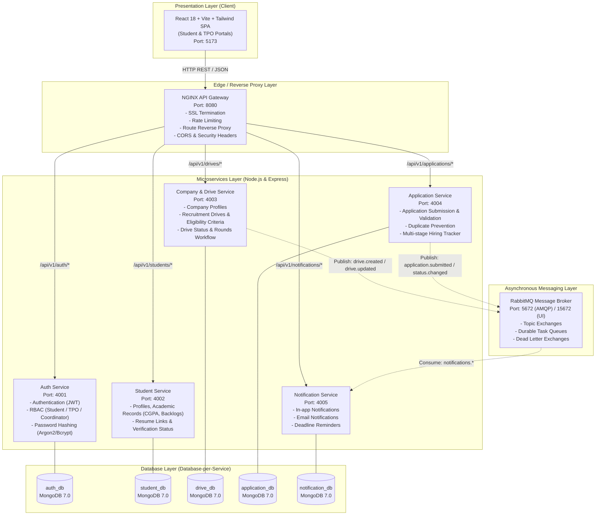
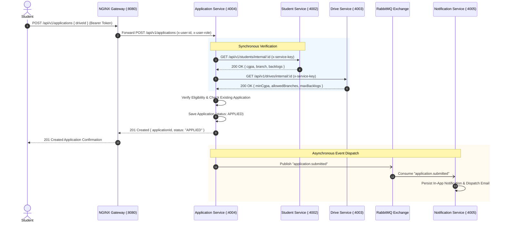
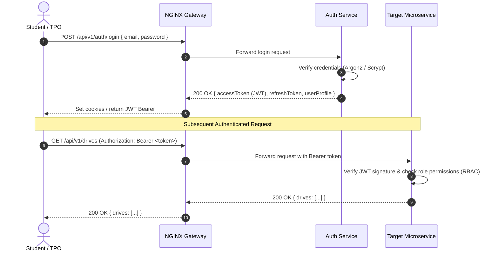

# RGUKT Ongole Placement Hub - System Architecture

## 1. High-Level System Architecture

The RGUKT Ongole Placement Hub is designed as an enterprise-grade, distributed microservices platform to manage the complete campus placement lifecycle for students, Training & Placement Office (TPO) administrators, faculty coordinators, and visiting recruiters.

---

## 2. Microservice Boundaries & Database Ownership

In strict compliance with microservice isolation principles:
- **Zero Shared Databases**: No service connects directly to another service's MongoDB instance.
- **Data Encapsulation**: Private state is accessible only via REST APIs or domain events.
- **Dedicated Volumes**: In Docker Compose, each MongoDB instance runs in an isolated container with its own named volume.

| Microservice | Internal Port | Database Name | Docker Container | Volume Name |
| :--- | :--- | :--- | :--- | :--- |
| **Auth Service** | `4001` | `rgukt_auth_db` | `auth-db` | `auth_data` |
| **Student Service** | `4002` | `rgukt_student_db` | `student-db` | `student_data` |
| **Company & Drive Service** | `4003` | `rgukt_drive_db` | `drive-db` | `drive_data` |
| **Application Service** | `4004` | `rgukt_application_db` | `application-db` | `application_data` |
| **Notification Service** | `4005` | `rgukt_notification_db` | `notification-db` | `notification_data` |

---

## 3. Communication Patterns

### A. Synchronous Communication (HTTP / REST)
Used when a client requires an immediate response (e.g., login, profile retrieval, drive listing) or when a service needs immediate, transactional verification:
- **Client to Services via Gateway**: All external traffic flows through NGINX on `http://localhost:8080/api/v1/...`.
- **Inter-Service Verification**: When an application is submitted, `application-service` synchronously verifies student eligibility criteria against `student-service` and `company-drive-service`.
- **Internal Security**: Inter-service synchronous calls include an internal service authorization header (`x-service-key`) to prevent unauthorized cross-service tampering.

### B. Asynchronous Communication (Event-Driven via RabbitMQ)
Used when processing can occur in the background without blocking the caller:
- **Decoupled Workflow**: State transitions publish domain events to a RabbitMQ Topic Exchange (`placement.topic`).
- **Events Published**:
  - `drive.published`: Triggers notification broadcasts to eligible students.
  - `application.submitted`: Triggers confirmation email and notification to student & TPO.
  - `application.status_changed`: Triggers progress alerts (e.g., shortlisted for interview).
  - `student.registered`: Triggers welcome email and initializes default notification preferences.

---

## 4. API Gateway Responsibilities

The NGINX API Gateway acts as the single public entry point:
1. **Reverse Proxying**: Maps public endpoints (`/api/v1/auth/*`, `/api/v1/students/*`, etc.) to respective internal microservices.
2. **Rate Limiting**:
   - Standard APIs: 30 requests/second per IP with a burst of 50.
   - Authentication APIs: 5 requests/minute per IP to guard against brute-force attacks.
3. **SSL/TLS Termination**: Centralized certificate handling for secure production deployments.
4. **CORS & Security Headers**: Adds `X-Content-Type-Options: nosniff`, `X-Frame-Options: DENY`, `Strict-Transport-Security`, and cross-origin resource sharing policies.
5. **Gateway Health Check**: Exposes `/health` to verify edge availability.

---

## 5. Authentication & Authorization Flow

The platform implements **Stateless JWT-based Authentication** with **Role-Based Access Control (RBAC)**:

### User Roles:
- `STUDENT`: Can manage personal profile, browse eligible drives, apply for drives, and view application status.
- `TPO_ADMIN`: Can create/update drives, verify student profiles, update application stages, access reports and audit logs.
- `COORDINATOR`: Faculty/student placement representative with department-scoped view privileges.

- **Access Token**: Short-lived (15 minutes), signed with asymmetric/HMAC-SHA256, contains `{ userId, email, role, department }`.
- **Refresh Token**: Long-lived (7 days), stored securely in `auth_db` to allow token rotation and revoking.

