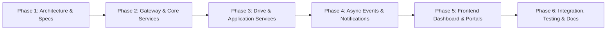

# RGUKT Ongole Placement Hub - Development Roadmap

This roadmap outlines the systematic, phased implementation of the RGUKT Ongole Placement Hub microservices ecosystem. In adherence to project guidelines, each phase must be fully verified and approved before proceeding to subsequent phases.

---

## Roadmap Phases Overview

---

## Phase Details

### Phase 1: Requirements Analysis and Architecture *(Current Phase)*
- [x] Identify business domains and user personas.
- [x] Decide the appropriate number of microservices (5 services + 1 API Gateway).
- [x] Define microservice responsibilities, boundaries, and validation standards.
- [x] Design database-per-service architecture and schemas.
- [x] Detail synchronous (REST) and asynchronous (RabbitMQ) communication patterns.
- [x] Formulate comprehensive API contracts.
- [x] Prepare project scaffolding structure in `placement-hub`.
- **Exit Criteria**: Architecture specifications and project structure reviewed and approved by user.

---

### Phase 2: Gateway, Auth Service & Student Service
- [ ] Implement NGINX API Gateway with rate-limiting and route definitions.
- [ ] Implement `auth-service` with JWT generation, password hashing, and role checks.
- [ ] Implement `student-service` with academic profile management and verification logic.
- [ ] Provision dedicated MongoDB databases (`rgukt_auth_db`, `rgukt_student_db`) in Docker Compose.
- [ ] Implement automated unit and endpoint tests for Auth and Student APIs.
- **Exit Criteria**: Working containerized Auth and Student services accessible via API Gateway.

---

### Phase 3: Authentication and Authorization *(Completed)*
- [x] Implement registration and login APIs.
- [x] Implement password hashing using bcrypt (salt rounds: 12).
- [x] Implement short-lived JWT access tokens.
- [x] Implement refresh token rotation with token reuse detection.
- [x] Implement logout and session revocation.
- [x] Implement role-based access control (Student, Admin, Recruiter).
- [x] Implement protected API routes and RBAC middleware.
- [x] Implement frontend authentication pages (Login, Register, Dashboard, User Management).
- [x] Implement frontend `<ProtectedRoute>` component with role verification.
- [x] Implement account status management (Active, Inactive, Suspended).
- [x] Comprehensive API documentation in `docs/AUTHENTICATION_API.md`.
- [x] Automated test suite in `services/auth-service/tests/auth.test.js`.
- **Exit Criteria**: Full authentication engine, RBAC, frontend auth flows, and tests ready for separate execution.

---

### Phase 4: Student Management Service *(Completed)*
- [x] Create student profile model and schemas in independent `rgukt_student_db`.
- [x] Store student identification details (Student ID, email, phone, gender, DOB).
- [x] Support branches (`CSE`, `ECE`, `EEE`, `MECH`, `CIVIL`, `CHEM`, `MME`) and academic batches.
- [x] Store CGPA and semester SGPA history.
- [x] Track active backlogs and backlog history.
- [x] Manage technical and non-technical skills.
- [x] Manage project portfolios and professional certifications.
- [x] Implement resume upload engine (Multer with PDF/DOC format and 5MB validation).
- [x] Implement dynamic weighted profile completion calculator.
- [x] Implement profile update APIs.
- [x] Implement student search and multi-filtering for authorized administrators.
- [x] Implement academic eligibility evaluation engine.
- [x] Build comprehensive Student Profile management UI (`StudentProfile.jsx`).
- [x] Build Administrator Candidate Directory & Verification UI (`AdminStudentSearch.jsx`).
- [x] Authored API documentation in `docs/STUDENT_SERVICE_API.md`.
- [x] Created automated test suite in `services/student-service/tests/student.test.js`.
- **Exit Criteria**: All student management APIs, resume uploads, profile UI, and tests ready for separate execution.

### Phase 5: Company & Recruiter Management (COMPLETED)
- [x] Implement `company-drive-service` company registration & profile management.
- [x] Recruiter account association & permissions management.
- [x] Company verification workflow (Admin verification/rejection with review notes).
- [x] Company search, multi-filter (industry, location, status), and pagination.
- [x] Dedicated MongoDB database (`rgukt_drive_db`) with compound & text indexes.
- [x] Recruiter Company Profile UI page (`RecruiterCompanyProfile.jsx`).
- [x] Admin Company Management UI console with verification modal (`AdminCompanyManagement.jsx`).
- [x] Synchronous inter-service API (`x-service-key`) for downstream microservices.
- **Exit Criteria**: Recruiters can register and manage company profiles, Admins can audit/verify/reject companies and manage recruiters, and data is isolated in `rgukt_drive_db`.

---

### Phase 6: Job Management Service (COMPLETED)
- [x] Implement job postings creation, editing, status management, and deletion.
- [x] Define job descriptions, technical skill prerequisites, workplace types, and locations.
- [x] Define salary packaging (Min/Max LPA, monthly stipend, currency, breakup).
- [x] Configure application deadlines and recruitment drive dates.
- [x] Configurable eligibility engine (Minimum CGPA, allowed branches, batch years, backlog limits, skills).
- [x] Full-text search and multi-parameter filtering (by branch, CGPA, package, location, workplace).
- [x] Job listing UI (`JobList.jsx`) and detailed job specification page (`JobDetails.jsx`).
- [x] Recruiter & Admin job management console with interactive posting modal (`RecruiterJobManagement.jsx`).
- [x] Real-time candidate eligibility auditor (`POST /api/v1/jobs/:id/check-eligibility`).
- [x] Synchronous inter-service API (`GET /api/v1/jobs/internal/:id`) with `x-service-key`.
- **Exit Criteria**: Recruiters and Admins can publish customized placement opportunities with dynamic eligibility rules, and students can explore drives and verify their academic qualifications in real-time.

---

### Phase 7: Placement Drive Management (COMPLETED)
- [x] Implement placement drive creation and company association.
- [x] Configure eligible engineering branches and academic cutoff requirements.
- [x] Configure drive registration deadlines and venue/platform links.
- [x] Schedule multi-stage recruitment rounds (Aptitude, Technical Interviews, HR Interviews).
- [x] Track drive lifecycle status (`DRAFT`, `UPCOMING`, `REGISTRATION_OPEN`, `REGISTRATION_CLOSED`, `IN_PROGRESS`, `COMPLETED`, `CANCELLED`).
- [x] Student placement drive registration with automatic academic cutoff validation.
- [x] Enforce duplicate prevention and ineligibility rejections (`INELIGIBLE_FOR_DRIVE`).
- [x] Drive scheduling and round management UI (`PlacementDrives.jsx`).
- [x] Administrator candidate roster management and round score updating modal.
- [x] Student registered drives portfolio and multi-round pipeline tracker.
- **Exit Criteria**: Placement drives are scheduled with multi-round pipelines (Aptitude, Tech, HR), eligible students can register, and administrators can monitor and progress candidate rosters.

---

### Phase 8: Application Service & Selection Workflow (Pending)
- [ ] Implement `application-service` (formal application submission, stage advancement, offer letter release).
- [ ] Student application lifecycle tracking and company response history.
- [ ] Placement statistics and reporting engine.

---

### Phase 9: Notification Service & Message Broker (Pending)
- [ ] Asynchronous event notification with RabbitMQ.
- [ ] In-app and email notifications for drive updates and round results.

---

### Phase 10: End-to-End Integration, Final Polish & Deployment
- [ ] Multi-container stack verification with Docker Compose.
- [ ] End-to-end user journeys validation.
- [ ] Production readiness review.

